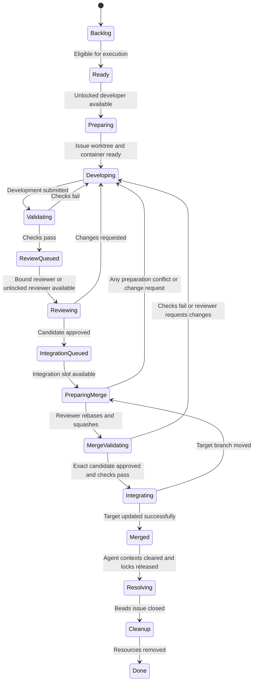

# Development Harness CLI Plan

Status: First CLI implementation completed on Windows, with real Codex development and Antigravity review. The harness used its own lifecycle to add a status feature and worker-boundary hardening. See [verification evidence and remaining limits](verification.md).

Latest interface decision (2026-10-11): Deliver an installable CLI executable, not an MCP server. This replaces both the original MCP interface and the subsequent FastMCP choice. The orchestrator controls the harness through CLI commands and polls structured JSON results; ACP remains the protocol for dispatching coding agents.

This document records the confirmed requirements, architecture decisions, operational policies, and implementation scope. The developer explicitly authorized implementation and delegated routine architectural decisions, including mitigations for the identified shortcomings. Numerical examples remain configurable rather than fixed requirements.

## Goal

Create a project orchestration CLI executable that a developer operates directly or through an orchestrator agent in a coding interface such as Codex or Google Antigravity (`agy`).

The orchestrator interprets requests and coordinates exclusively through harness CLI commands. The harness owns the execution loop, worker lifecycle, assignments, validation, integration, and recovery.

The harness must eventually be able to develop and improve itself using this same workflow.

```text
Developer <-> Orchestrator <-> Harness CLI <-> Host service <-> ACP coding agents
                                  |
                                Beads <-> Perles
```

## Confirmed requirements

- Use Agent Client Protocol (ACP) to dispatch coding agents.
- Support modular provider adapters so additional coding harnesses can be added without rewriting orchestration.
- Verify Codex and Google Antigravity first. Broader compatibility remains a design goal rather than a first-release verification commitment.
- Use Python managed by uv for the runtime and scripting.
- Use mise-en-place to manage external tooling.
- Launch the harness in a project and manage that project's agents and issues.
- Use Beads as the issue tracker and Perles as the issue TUI.
- Rename the architect agent to the orchestrator.
- Expose a CLI executable rather than an MCP server. The orchestrator coordinates through CLI commands with structured JSON output.
- The harness follows a deterministic execution loop and state machine.
- Create long-lived agents that the orchestrator can inspect and interact with.
- Configure the maximum number of harness-managed agents through configuration or an environment variable.
- Run development and review concurrently using separate producer and consumer queues.
- Give each executable issue its own Git worktree and branch.
- Clean up issue resources at the end of their lifecycle.
- If Git is not initialized, ask the developer whether to initialize it.
- Run the project service on the host machine.
- Perform issue development, review, and rebase/squash preparation in an isolated environment with full worker permissions inside that environment.
- Use one development container per issue in the first release; keep the execution backend modular for other sandbox implementations.
- Continue execution when the orchestrator chat disconnects.
- Support interruption and durable recovery.
- Automatically integrate approved and validated changes using a rebase followed by a squash into one commit on the current target branch.
- Allow the review agent to prepare the rebase and squash and request further development if the target branch has moved.
- Lock each assigned developer and reviewer to their issue until it is merged.
- Preserve separate developer and reviewer issue conversations through all revisions and integration attempts; clear their active issue context after merge.
- Have the orchestrator poll the CLI for progress, responses, and requests; do not require notifications or automatic chat wake-up.
- Have CLI help, an instructions command, and machine-readable command schemas describe the orchestrator workflow and polling behavior.
- Pause stalled issues individually and await developer input while retaining their agent locks and issue contexts.
- Pause the entire project execution loop when a dispatched provider reaches a usage limit; preserve all assignments and contexts.
- Coexist with manual commits and uncommitted work on the host project checkout.
- Pull the latest target branch before each integration attempt, then rebase, squash, validate, and merge.
- Route every conflict during target refresh, rebase, or squash through the harness back to the issue's locked developer. The reviewer prepares Git changes and reviews them but does not implement substantive conflict resolutions.
- Beads owns issue data; the harness owns execution records, logs, and session metadata.
- Start with Windows, while designing platform boundaries to support other operating systems later.
- Implementation is authorized; the developer's later switch from MCP to CLI supersedes the earlier interface choice.

## Meaning of deterministic execution

Determinism applies to workflow decisions: given the same recorded events and configuration, the harness makes the same assignments and transitions.

Agent implementations and review judgments remain variable inputs. The harness validates those inputs before applying state changes.

## Proposed architecture and ownership

| Component | Responsibility |
|---|---|
| Orchestrator | Translate developer intent into issues, configure agent pools, answer worker questions, and handle escalations through CLI commands. |
| Persistent project service | Run on the host; own the scheduler, agent lifecycle, queues, worktrees, validation, final Git integration, and polling queries; survive chat disconnections. |
| ACP provider adapters | Launch agents, negotiate capabilities, manage conversations, normalize output, cancel work, and reconnect. |
| Execution backend | Run workers, validation commands, and candidate rebase/squash preparation inside an issue-specific development container; support additional sandbox backends later. |
| Beads | Own issue descriptions, priorities, dependencies, comments, and resolution status. |
| Harness database | Persist assignments, workflow stages, session references, operations, events, and artifact references. |
| Perles | Provide the developer's issue TUI against the same Beads project. |
| CLI executable | Provide project selection, command help, structured JSON results/errors, stable exit codes, orchestrator instructions, and polling against the independent host service. No MCP registration or notification bridge is required. |

There is one active scheduling authority per project. Multiple CLI invocations can inspect or control it without creating competing schedulers.

Provider adapters and execution backends are separate. Adding another coding provider should not require changes to container management. Adding another operating system should not require changes to the scheduler.

The proposed first provider integrations are:

- Codex through the maintained Codex ACP adapter.
- Antigravity through Google's published ACP server.

Launch commands, authentication integration, permission configuration, capabilities, and provider-specific behavior belong inside those adapters. Protocol and dependency versions should be pinned and capabilities negotiated rather than assumed.

Worker ACP adapters and CLI command handling are separate concerns: ACP dispatches coding agents, while CLI commands control and inspect the project service.

The first implementation must verify Codex and Antigravity both as orchestrators invoking the CLI and as ACP workers with a Windows host and issue-specific development containers.

The host service owns authoritative project state and the final target-branch update. Workers manipulate their issue checkout inside the container. The execution backend owns host/container path mapping and candidate transfer; container configuration must avoid giving full-permission workers direct write access to host control state or the authoritative target branch.

## Long-lived agents

An agent has a durable identity, role, provider profile, mailbox, and assignment history. Its process remains available between assignments when supported.

An agent lives across many issues, but its conversation context is issue-specific. Developer and reviewer conversations remain separate and persist through development, change requests, review, rebase/squash preparation, and integration retries.

Once assigned, a developer is locked to that issue until merge. A reviewer is selected when the issue first reaches review and is then locked to the same issue until merge, including while the developer addresses changes. Waiting on another stage does not make either agent available for a different issue.

After merge, close both issue sessions and clear their active context before making either agent available again. Retain archived transcripts and artifacts for audit and recovery, but do not inject the completed conversation into the next issue. Agent identity, provider profile, and assignment history survive the context reset. An underlying ACP process may be restarted as issue containers are created and removed without losing that durable identity.

### Agent lifecycle

```text
created -> starting -> idle -> assigned_working <-> assigned_waiting
                                  |
                                  +-> interrupted -> recovering
                                  +-> unavailable
                                  +-> merged -> resetting_context -> idle

idle/assigned -> draining -> stopped
```

- Each agent has at most one active issue lock.
- Only an agent without an issue lock and with completed context reset is available for another assignment.
- Assigned agents alternate between working and waiting while retaining their issue lock and conversation.
- Developers and reviewers occupy separate pools with a shared hard cap on harness-managed agents.
- The cap applies to managed agents, including idle and waiting agents, rather than only active prompts.
- Reviewer capacity is reserved so developers cannot consume the entire limit; execution requires both developer and reviewer capacity.
- Lowering the cap drains excess agents after their locked issues finish rather than discarding active context.
- Messages to assigned agents are queued unless an explicit interruption requests a change to the active turn.
- Explicit cancellation is a separate terminal path: stop work, archive issue context and changes, and release locks after cancellation is reconciled. Cancellation must not imply a successful merge.

## Issue state machine



### Transition rules

1. **Eligibility:** An issue needs sufficient acceptance criteria, satisfied dependencies, and an execution-enabled status. Epics group work; executable child issues enter the queues.
2. **Scheduling:** Select work by recorded priority, queue order, and a stable tie-breaker. Claim it atomically so two developers cannot receive the same issue.
3. **Preparation:** Create an issue branch, worktree, and dedicated development container. Lock the assigned developer to the issue before implementation begins.
4. **Development:** Dispatch the issue description, acceptance criteria, relevant context, and previous review findings into the developer's retained issue conversation.
5. **Validation:** The harness executes configured checks inside the issue environment and captures results. An agent's claim that tests passed does not replace those checks.
6. **Review:** Select an available reviewer for the first review and lock it to the issue. Review a frozen commit and acceptance-criteria revision. Require a structured approval, change request, or blocked result. Ending an ACP turn alone does not mean an assignment succeeded.
7. **Revision:** Return findings to the issue's locked developer using the existing conversation and worktree. The reviewer keeps its own context and lock while waiting for the revision.
8. **Merge preparation:** Acquire the serialized integration slot. Pull the latest configured target branch into an isolated integration checkout, incorporating current local and remote target history without altering the developer's dirty checkout. The locked reviewer rebases the issue changes and squashes them into one candidate commit in the issue container. Approval of the earlier candidate does not automatically approve the new commit. Every conflict during pull/target refresh, rebase, or squash invalidates approval and returns to the locked developer through the development lifecycle; the reviewer never silently resolves substantive conflicts.
9. **Merge validation:** The reviewer explicitly approves the exact rebased/squashed candidate and current acceptance-criteria revision. The harness independently reruns configured checks against that candidate. The reviewer may invalidate approval and return the issue to development when target movement, conflicts, or changed behavior require revisions.
10. **Integration:** The host harness integrates only the approved, validated candidate with the recorded current target as its parent. If the target has moved before the final update, retain both agent locks and return to merge preparation. Never overwrite intervening target changes or merge a stale candidate. Release the integration slot when work returns to development or is paused, blocked, or interrupted, so unrelated approved issues can continue. Recover abandoned integration leases after restart.
11. **Context reset:** After successful merge, durably close both issue sessions and clear active context before releasing the developer and reviewer for new issues.
12. **Resolution:** Close the Beads issue after successful integration and validation. Recover context reset and Beads closure independently if a crash occurs after merge.
13. **Cleanup:** Remove the issue container and worktree and delete the integrated issue branch. Retain transcripts, findings, validation evidence, and merge provenance.

### Concurrent queues

Development and review run concurrently across different issues.

A developer remains locked after submission and waits for review or integration. An unlocked reviewer consumes a first-review assignment and remains locked through all revisions until merge. Later review passes use that issue's existing reviewer. Change requests resume the issue's existing developer.

The same issue is not developed and reviewed concurrently. Review operates on a frozen candidate. Parallelism comes from different issues occupying different stages with distinct assigned agents.

For example, with two developers and two reviewers, issue A can be reviewed while issue B is developed. Developer A is waiting on issue A and cannot start issue C. A developer/reviewer pair becomes fully available for another issue only after merge and context reset.

A configurable review-queue limit provides backpressure. Separate developer and reviewer capacity prevents starvation. Scheduler decisions use issue-lock availability, not whether an agent currently has an active ACP turn.

### Interruption and exceptional conditions

Pause, cancellation, dependency blocking, authentication failures, and exhausted retry limits are additional lifecycle conditions. They preserve the last valid stage and its artifacts.

An issue needing developer input or exceeding its bounded failure/revision policy is paused independently while unrelated issues continue. Its developer and reviewer remain locked, and a durable request is exposed through polling. Resume requires resolving the request or an explicit execution command; cancellation is the explicit way to abandon an issue and release its resources.

Provider usage exhaustion pauses the entire project loop, across all providers and both roles. Persist the pause reason, stop new dispatches and integration attempts, interrupt active agent turns while preserving artifacts and context, and reconcile operations that already completed. Do not automatically switch providers or repeatedly retry exhausted usage. Inspection, polling, and responses remain available while paused. Resume through `harness execution resume` after usage is available; immediately pause again if the provider still reports exhaustion.

Integration failures, failed validation, and unavailable agents must produce explicit recorded outcomes rather than falsely closing an issue. Cleanup failure remains retryable without repeating successful integration.

## Orchestrator CLI commands

These CLI operations express commands and queries. The harness validates preconditions and performs the resulting transitions.

| Area | Commands | Behavior |
|---|---|---|
| Project setup | `harness inspect`, `harness init`, `harness instructions` | Inspect prerequisites, initialize approved project resources, and retrieve the orchestrator operating guide. Missing Git returns `git_initialization_required`, allowing the orchestrator to ask the developer. |
| Configuration | `harness config show`, `harness config update`, `harness adapters list` | Inspect effective settings, change pool targets and policies, and discover providers and capabilities. |
| Issues | `harness issue create`, `harness issue show`, `harness issue list`, `harness issue update`, `harness issue delete` | Manage Beads issues. Deletion first quiesces active work and retains the harness audit history. |
| Dependencies | `harness dependency add`, `harness dependency remove` | Manage ordering and reject dependency cycles. |
| Agent lifecycle | `harness agent create`, `harness agent show`, `harness agent list`, `harness agent retire` | Create durable agents, inspect issue locks and assignments, and drain or stop them. |
| Agent interaction | `harness agent send`, `harness agent messages`, `harness agent interrupt` | Queue follow-up messages, inspect responses, or interrupt an active turn. |
| Execution | `harness execution start`, `harness execution pause`, `harness execution resume`, `harness execution cancel` | Control the project or a particular issue. Pause supports draining or immediate interruption. |
| Inspection | `harness execution show`, `harness execution list`, `harness artifact show` | Inspect workflow history, commits, diffs, logs, checks, and review findings. |
| Polling | `harness updates poll`, `harness updates ack` | Poll durable progress, agent responses, and pending requests using a consumer cursor; acknowledge handled updates. No event subscription or automatic wake-up. |
| Escalations | `harness request respond` | Answer a worker question or resolve a recorded decision request. |

There is no ordinary CLI command for arbitrarily setting a workflow stage or bypassing review. For example, updating acceptance criteria during review creates a new revision and invalidates the old review.

Mutating commands accept an idempotency key. Updates accept an expected revision. Retrying an interrupted CLI invocation must not create another issue, agent, or assignment.

Git initialization requires the developer's decision; launching the CLI or connecting to the service does not initialize a repository.

## Worker CLI commands

Workers receive separate, assignment-scoped CLI commands. The worker credential is supplied through its container environment; it cannot authorize orchestrator commands.

| Command | Purpose |
|---|---|
| `harness worker assignment` | Read the issue, constraints, and current revision. |
| `harness worker submit-development` | Submit the candidate commit and implementation report. |
| `harness worker submit-review` | Submit a verdict and findings for an exact candidate and acceptance-criteria revision. |
| `harness worker submit-merge` | Submit the reviewer's rebased/squashed candidate, target-base commit, and final approval for harness validation and integration. |
| `harness worker request-guidance` | Create a durable question for the orchestrator. |

Workers submit results. The harness validates them and advances the state machine.

## Polling and orchestrator instructions

The orchestrator polls CLI commands rather than receiving pushed events. There is no MCP server, resource subscription, automatic idle-chat wake-up, or provider-specific notification bridge.

The harness remains internally driven by worker responses and recorded state changes. Routine transitions do not wait for an orchestrator poll. Guidance requests and exceptional failures wait for a recorded response while unrelated issues continue.

### Polling contract

`harness updates poll` accepts a consumer identity, a cursor, and a page limit and returns:

- Durable updates after that cursor, including progress, agent messages, approvals, change requests, and resolution outcomes.
- Pending guidance or decision requests, including requests that remain unresolved after their original update was acknowledged.
- A compact execution summary and agent issue-lock status.
- The next cursor, whether more updates are available, and a recommended polling interval.

Each update includes an update ID, issue ID, agent ID where applicable, assignment attempt, type, and payload or artifact reference.

Consumers drain additional pages before waiting for the recommended polling interval. Retries from the same cursor return the same persisted updates. `harness updates ack` persists the consumer's handled cursor, allowing another chat to resume from it after reconnecting.

Acknowledging an update does not resolve a guidance request. The orchestrator uses `harness request respond` to answer that request.

When the orchestrator stops polling or its chat closes, the service continues ordinary work. Pending questions remain visible on subsequent polls; the harness does not try to wake the chat.

### CLI operating guide and output contract

The executable provides concise help through `harness --help`, an operating guide through `harness instructions --json`, and a machine-readable command catalog through `harness schema --json`.

Every orchestrator command supports structured JSON results, structured error codes, and documented process exit codes. JSON mode emits only the result on stdout and logs diagnostics to stderr. Accept long descriptions and structured arguments through files or stdin so agents do not need fragile shell quoting. Global project selection allows commands to run from any directory.

The instructions tell the orchestrator to:

1. Coordinate exclusively through harness CLI commands; delegate code changes and project commands.
2. Inspect project readiness and ask the developer before Git initialization if needed.
3. Create issues with acceptance criteria and dependencies and configure developer/reviewer agents within the cap.
4. Start the approved execution scope.
5. Poll updates, inspect referenced artifacts as needed, answer requests, and acknowledge handled updates.
6. Follow pagination and the returned polling interval instead of issuing a tight polling loop.
7. Let the harness assign work, run checks, drive revisions, and integrate validated changes.
8. Explain pauses, blocked requests, and failures to the developer using recorded harness state.
9. After reconnecting, use the persisted consumer cursor and pending requests to continue coordination.

CLI invocations are short-lived clients. The host service owns long-running work and continues when a command exits or the orchestrator chat closes. The CLI offers explicit service start, status, and stop commands. Service communication is an internal authenticated control channel, not an MCP interface.

Worker commands use assignment-scoped credentials and reject stale attempts or wrong-role submissions. Instructions guide agents; the harness enforces scheduling and transition invariants.

## Persistence, interruption, and recovery

The service records an operation's intent before starting it, then records its outcome. On restart it reconciles unfinished operations against actual processes, containers, Git state, and Beads state.

Required recovery behavior includes:

- Persistent queues, messages, transcripts, assignments, issue locks, and polling cursors.
- Preserved worktrees and partial changes after interruption.
- Session reconnection where the adapter supports it.
- Context reconstruction when a session cannot be restored.
- Recovery from a crash between merging code, clearing agent context, releasing issue locks, and closing the Beads issue.
- Recovery from interruption during reviewer rebase/squash preparation, including incomplete Git operations and approval invalidation when the target changes.
- Retryable cleanup without repeating successful integration.

Beads and the harness database cannot share one transaction. Their updates need recorded operations and reconciliation. Perles edits must also be detected and incorporated.

The proposed definition of resumability is no lost recorded project state and no blind repetition of completed lifecycle operations.

Exact continuation halfway through an arbitrary shell command or model generation cannot be guaranteed. Interrupted commands need inspection or explicit retry rules. Native conversation restoration depends on negotiated agent capabilities. Context reconstruction is a recovery fallback, not an identical continuation of the original conversation.

### Developing the harness through itself

The running service uses a fixed installed version while workers modify its repository.

Upgrading that service becomes an explicit restart and migration operation after validation. Workers modifying the source repository do not replace the running service in the middle of an assignment.

## Configuration and tooling

The executable exposes the CLI directly; FastMCP and the MCP SDK are not application dependencies. ACP remains the worker-dispatch protocol.

Use project configuration with environment-variable overrides.

The following values are illustrative proposals, not approved numerical defaults. Host execution, issue-specific containers and conversations, agent locking until merge, automatic rebase/squash integration, and orchestrator polling are confirmed.

```toml
[agents]
max_agents = 4
developers = 2
reviewers = 2

[execution]
enabled = false
max_review_queue = 4
max_revision_cycles = 5

[service]
location = "host"

[workspace]
backend = "devcontainer"
isolation = "issue"

[integration]
target_branch = "main"
strategy = "rebase_squash"
prepare_by = "reviewer"
automatic_merge = true
automatic_push = false
refresh_target = true
conflicts = "return_to_development"

[limits]
provider_usage_exhausted = "pause_project"
stalled_issue = "pause_issue"

[orchestrator]
interaction = "poll"
poll_interval_seconds = 10
```

`HARNESS_MAX_AGENTS` overrides the agent cap. Execution starts through an explicit CLI command.

- uv manages the Python runtime and project dependencies.
- mise pins external tooling.
- Provider profiles define executable configuration, model settings, and adapter capabilities.
- Platform-specific process handling, paths, container access, and client registration belong behind interfaces.
- Worker permissions are full within their development containers.
- Perles requires Dolt server mode for its Beads Dolt integration, so project setup must account for that service.

## Recorded architecture decisions

The developer answered all five architectural questions:

1. **Host/container layout:** Run the project service on the host. Agents perform issue work in containers or an equivalent sandbox with full permissions inside that environment.
2. **Integration authority:** Automatically merge approved and validated changes using rebase and squash. The reviewer can prepare the rebase/squash and invalidate approval or request changes when the target branch has moved.
3. **Agent longevity:** Reuse agent identities across many issues with issue-specific conversations. Lock the developer and reviewer to their issue until merge, preserve context across revisions, then clear both active contexts.
4. **Container isolation:** Use one container per issue.
5. **Orchestrator interaction:** Replace event-driven orchestrator delivery with polling. CLI instructions and help must describe how the orchestrator should operate the harness.

### Recorded interface change

The developer changed the product interface to a CLI executable: "actually I changed my mind. I don't want to make this an MCP. Please make this into a CLI executable instead."

This supersedes the earlier MCP and FastMCP requirements. Keep ACP dispatch, the persistent host service, Beads/Perles, isolation, agent locking, polling, integration, and recovery policies. Orchestrator instructions move to CLI help, an instructions command, and machine-readable command schemas.

### Recorded operational answers

1. **Stalled issues:** Pause the affected issue and await developer input. Keep both issue-specific agent contexts and locks; other eligible issues continue.
2. **Provider limits:** A provider usage limit pauses the entire project execution loop rather than only the affected issue or provider. Do not silently fail over.
3. **Target branch ownership:** Coexist with manual development. Pull the latest main before each merge, then rebase and squash. Protect uncommitted work and never force-reset or stash the developer's checkout automatically.
4. **Reviewer responsibility:** The reviewer performs Git preparation. Any pull/rebase/squash conflict invalidates approval and returns to the same developer through the normal development, validation, and review cycle.

No architecture or operational questions remain from the discussion. Concrete pool sizes, polling intervals, retry limits, and validation commands are configuration choices.

### Selected mitigations for operational shortcomings

- **Pool stalls:** Expose working versus waiting states, retain locks, bound retries/revision cycles, and pause with actionable durable requests instead of looping indefinitely.
- **Review reliability:** Bind verdicts to exact commits and issue revisions; validate clean candidate snapshots and preserve a trusted validation policy outside worker-controlled changes.
- **Isolation:** Use issue-specific containers with isolated Git metadata, no Docker daemon socket or writable host control directory, trusted container setup, and explicit credential injection. Avoid executing candidate-controlled host lifecycle hooks.
- **Recovery:** Persist operation intent/outcomes and assignment generations, reject obsolete worker results, reconcile or stop existing containers before retrying, and document native resume versus reconstructed context.
- **Integration contention:** Serialize target updates, refresh local/remote history per attempt, require a final expected-target check, and release the integration slot when conflicts return to development. Never disturb dirty host worktrees.
- **Polling continuity:** Persist consumer cursors and unanswered requests; keep ordinary scheduling independent of the chat. Provide compact summaries and polling guidance.
- **Project memory:** Keep architectural decisions and conventions in versioned project documents. Archive issue conversations without carrying them into new issue sessions.
- **Resources:** Bound container CPU/memory, command duration, log size, revision attempts, and queue growth through configuration; pause globally on provider usage exhaustion.
- **Platform verification:** Exercise host orchestration on Windows separately from Linux-container candidate checks.
- **Self-improvement:** Keep the known-good installed service running; evaluate candidates in disposable projects with crash/recovery and migration checks. Provide backup, explicit upgrade, and an out-of-band recovery path. Merging source does not hot-reload the service.

## Proposed first-release build scope

- A uv-managed Python package with a Windows host CLI and persistent project service.
- An installable CLI executable with human-readable and JSON output, stable exit codes, and a persistent host service that continues between CLI invocations.
- Modular ACP provider adapters verified for Codex and Antigravity, including authentication, issue sessions, responses, cancellation, and supported recovery.
- Modular execution backends with issue-specific development containers implemented first.
- Beads integration and Perles setup against the same project issue store.
- Durable state, operation records, issue locks, agent mailboxes, transcripts, polling cursors, and reconciliation after interruption.
- The confirmed concurrent development/review lifecycle, reviewer rebase/squash preparation, host-controlled automatic integration, context reset, resolution, and cleanup.
- Orchestrator and assignment-scoped worker CLI command surfaces, command help, machine-readable schemas, operating instructions, and a polling workflow.
- Configurable agent limits, provider profiles, validation commands, queue/resource limits, bounded retry policies, per-issue stall handling, and global provider-usage pause.
- Documentation and a demonstration of improving the harness repository through its own workflow.

Other providers, alternative sandbox implementations, and native macOS/Linux host verification are extension points beyond the first verification pass. They must not require a scheduler rewrite.

Automatic remote push is not enabled in this proposed first-release scope; remote publication can be configured separately.

## Proposed acceptance criteria

1. **Host and isolation:** Launch in a project on Windows; keep the service on the host and run issue code changes, project commands, and merge preparation in the issue's container.
2. **CLI interoperability:** Have both Codex and Antigravity invoke the executable as orchestrators, retrieve instructions and command schemas, and coordinate through CLI JSON output without MCP.
3. **Worker interoperability:** Dispatch development and review through both ACP adapters and verify negotiated capabilities rather than relying on provider-specific assumptions.
4. **Agent limits and locks:** Enforce the configured/environment-overridden cap and prove that waiting developers and reviewers cannot be reassigned before their issue merges.
5. **Concurrent pipeline:** With at least two developers and two reviewers, develop one issue while reviewing another without overlapping mutation and review on the same issue.
6. **Revision continuity:** Request changes, return to the same developer and reviewer contexts, and preserve both locks through repeated development/review passes.
7. **Rebase/squash integration:** Produce one issue commit on the current target base, require reviewer approval and harness validation for that exact candidate, and have the host service integrate it automatically.
8. **Target movement:** Move the target during integration preparation and prove that stale approval cannot merge, the reviewer reassesses/rebases the candidate, and requested changes return to the same developer.
9. **Context reset:** After merge, clear both active issue contexts before reassignment while retaining archived transcripts and durable agent identities.
10. **Recovery:** Interrupt development, review, rebase/squash, target update, context reset, Beads closure, and cleanup; resume from recorded state without duplicate completed operations or lost issue locks.
11. **Polling:** Disconnect and reconnect the orchestrator, retrieve updates from its durable cursor, handle pagination, and retain unresolved guidance requests until explicitly answered.
12. **Issue lifecycle:** Preserve Beads ownership of issue data, reflect Perles edits, reject dependency cycles, and close issues only after validated integration.
13. **Cleanup:** Remove completed issue containers, worktrees, and branches, preserve evidence, and retry partial cleanup without repeating integration.
14. **Git initialization:** Detect a project without Git and require the developer's decision before initializing it.
15. **Self-improvement:** Complete a development/review/merge cycle on an issue in the harness repository using the harness itself.
16. **Stalled issues:** Pause an issue after a bounded failure policy or unresolved guidance, preserve its agent locks and contexts, and expose a durable request without stopping unrelated work.
17. **Usage exhaustion:** Simulate a provider usage limit and prove that all project dispatch and integration pause, persisted state survives restart, polling remains available, and no automatic provider fallback occurs.
18. **Manual coexistence:** Advance local and remote main while keeping uncommitted host edits; refresh target history for each integration and prove no developer changes are overwritten, stashed, or force-reset.
19. **Conflict ownership:** Trigger pull/rebase/squash conflicts and prove the reviewer reports them, approval is invalidated, and the same developer resolves them before validation and another review.

Validation during implementation should combine deterministic scheduler and crash-recovery checks using controlled ACP fixtures with real end-to-end Codex and Antigravity runs. Passing simulated runs alone does not establish provider compatibility.

## Implementation authorization

The developer explicitly authorized implementation: "Also find a recommended way to address the shortcomings. I give you power of implementation because I trust that you will follow the best architectural decisions."

Proceed with the recorded requirements and selected mitigations. Routine implementation and verification choices do not require another approval. Keep the developer informed of material limitations or external prerequisites discovered during real integration checks.

## References

Documentation was consulted during planning on 2026-10-11. Compatibility and capabilities must be verified against pinned versions during implementation.

- [Agent Client Protocol introduction](https://agentclientprotocol.com/get-started/introduction)
- [ACP agent registry](https://github.com/agentclientprotocol/registry)
- [Codex ACP adapter](https://github.com/agentclientprotocol/codex-acp)
- [Antigravity ACP distribution](https://github.com/agentclientprotocol/registry/blob/main/antigravity-acp/agent.json)
- [Google Antigravity getting started](https://antigravity.google/docs/getting-started?tab=cli)
- [ACP session setup and restoration capabilities](https://agentclientprotocol.com/protocol/v1/session-setup)
- [ACP prompt turns and session updates](https://agentclientprotocol.com/protocol/v1/prompt-turn)
- [Beads](https://github.com/gastownhall/beads)
- [Perles and its requirements](https://github.com/zjrosen/perles#requirements)


### Selected adapter architecture (0.1.4)

`CodingHarnessAdapter` is an abstract base class in `adapters/__init__.py`.
That module contains the shared ACP lifecycle, `LaunchContext`, public JSON/update
and factory types, and the live registry. `Codex` and `Antigravity` subclass the
base, implement `setup(LaunchContext) -> list[str]` with `typing.override`, and
retain their provider defaults and credential launch integration. Antigravity
retains native OAuth bootstrap. `GenericACPAdapter` supports generic ACP profiles;
the old concrete adapter names remain aliases. No implements decorator is used.

The base starts an isolated ACP connection after the provider setup hook,
negotiates v1 and capabilities, authenticates when configured, creates/restores
sessions with missing-session fallback, selects mode/model, prompts, cancels,
conditionally closes sessions and performs bounded transport shutdown. The engine
retains transcript fallback and global quota handling. The backend retains fenced
credential copies/environment and all container ownership/isolation/resource/Git
transport policy. Engine teardown revokes scoped worker credentials before
cancellation-shielded transport close and container quiescence, preserving files
and issue context. Request scope, generation checks, journal transactions and
scheduler transitions remain unchanged.

Extensions subclass the ABC and implement the setup hook, then register a
`(Profile, Emit) -> CodingHarnessAdapter` factory before validating a profile.
They may retain their own constructor and members and inherit the ACP lifecycle;
no scheduler changes are required. Registry validation rejects unknown provider
keys before pool creation, binding or dispatch, including mutated profiles.
See the README for a complete extension recipe and the public lifecycle signatures.

Pyright checks all `src` in strict mode plus the adapter subclass fixture, using
the locked uv dependency. Typed recursive JSON validation and narrowing contain
external SDK, SQLite, HTTP and CLI inputs. Contract coverage includes abstract
construction, concrete inheritance, a third-party subclass through the engine,
and rejection of incompatible overrides. CI uses Pyright, Ruff, pytest and package
builds on both platforms. No automatic self-update is introduced; live provider
and host verification remains separate from controlled regression evidence.
